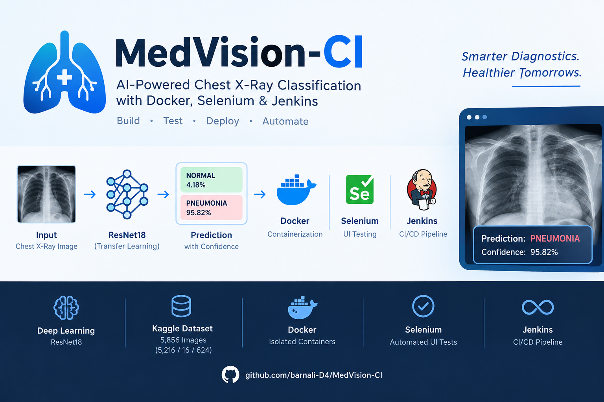
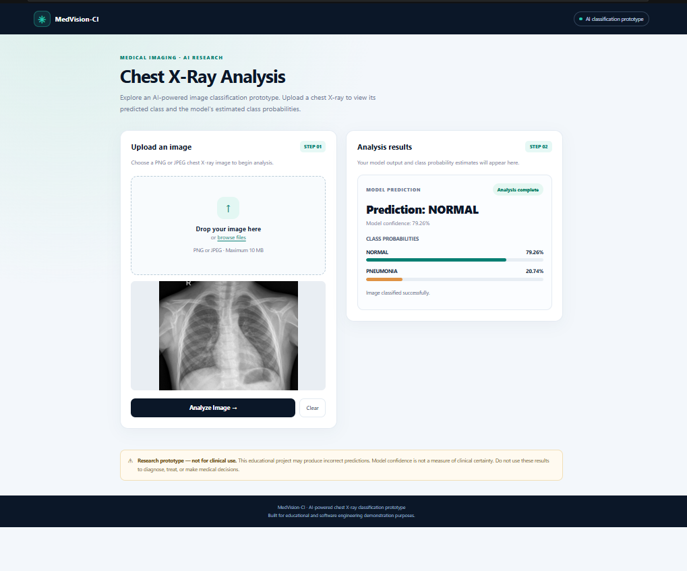

# MedVision-CI
### AI-Powered Chest X-Ray Classification with Automated Testing and CI/CD

**Project Type:** AI/ML + DevOps

**Made by:** [Barnali Bhowmik](https://github.com/BarnaliBhowmik)

**Repository:** [MedVision-CI @ GitHub](https://github.com/barnali-D4/MedVision-CI)



---

## 1. Project Overview

MedVision-CI is an AI-powered chest X-ray classification prototype that categorizes uploaded images as **NORMAL** or **PNEUMONIA** using a fine-tuned ResNet18 model.

The project integrates a Flask web application with automated testing, Docker containerization, and a Jenkins CI/CD pipeline. It demonstrates how an AI application can be tested, packaged, and validated through an automated development workflow.

**Objective:** Integrate machine learning with practical DevOps tools to automate application testing, container builds, and health verification.

> **Disclaimer:** This project is for educational purposes only. It is not a clinically validated diagnostic system and must not be used to make medical decisions.

## 2. Technology Stack

| Component | Technology |
|---|---|
| Programming language | Python |
| Machine learning | PyTorch, ResNet18 |
| Web application | Flask, HTML, CSS, JavaScript |
| Unit and API testing | pytest |
| Browser automation | Selenium WebDriver, Chrome |
| Containerization | Docker, Docker Desktop |
| CI/CD automation | Jenkins |
| Version control | Git, GitHub |
| Model training | Google Colab GPU |
| Development environment | Windows, VS Code, PowerShell |

## 3. Project Structure

```text
MedVision-CI/
├── app/
│   ├── app.py
│   ├── image_validator.py
│   └── templates/
│       └── index.html
├── ml/
│   ├── predict.py
│   └── models/
│       ├── class_labels.json
│       └── medvision_resnet18.pth
├── tests/
│   ├── api/
│   │   ├── test_app.py
│   │   └── test_prediction.py
│   ├── unit/
│   │   └── test_image_validator.py
│   └── selenium/
│       └── test_ui.py
├── data/
│   └── raw/
├── docs/
│   └── images/
│       └── medvision-output.png
├── reports/
├── download_dataset.py
├── inspect_dataset.py
├── health_check.py
├── Dockerfile
├── Jenkinsfile
├── requirements.txt
├── LICENSE
├── README.md
├── .dockerignore
└── .gitignore
```

### Key components

| File / Directory | Purpose |
|---|---|
| `app/app.py` | Flask routes, image uploads, and prediction responses |
| `app/image_validator.py` | Validates uploaded image files |
| `app/templates/index.html` | Web interface for image upload and classification |
| `ml/predict.py` | Loads the trained model and performs inference |
| `ml/models/` | Stores model weights and class labels |
| `tests/unit/` | Unit tests for image validation |
| `tests/api/` | API and prediction endpoint tests |
| `tests/selenium/` | Automated browser and image-upload tests |
| `Dockerfile` | Defines the application container image |
| `Jenkinsfile` | Defines the automated CI/CD pipeline |
| `health_check.py` | Verifies the application's health endpoint |
| `download_dataset.py` | Dataset download utility |
| `inspect_dataset.py` | Dataset inspection utility |
| `.dockerignore` | Excludes unnecessary files from the Docker build context |
| `docs/images/` | Project screenshots and documentation assets |
| `reports/` | Location for generated reports |

## 4. System Architecture

```text
                Developer
                    |
                    v
              GitHub Repository
                    |
                    v
              Jenkins Pipeline
                    |
       +------------+-------------+
       |            |             |
       v            v             v
  Unit/API      Selenium UI    Docker Image
    Tests        Tests Build
                    |
             Chrome in Docker
                    |
                    v
            Container Health Check
                    |
                    v
             Build Result


       Flask Web Application
                    |
             Upload X-ray Image
                    |
             Image Validation
                    |
             ResNet18 Inference
                    |
                    v
          NORMAL / PNEUMONIA
          Confidence + Probabilities
```

## 5. Implementation Workflow

1. **Model development:** Trained and fine-tuned a ResNet18 image classifier using Google Colab GPU.
2. **Application development:** Integrated model inference into Flask with image upload, prediction labels, confidence, and class probabilities.
3. **Automated testing:** Created unit tests, API tests, and Selenium browser tests.
4. **Containerization:** Packaged the Flask application, model, and dependencies into a Docker image.
5. **CI/CD integration:** Configured Jenkins to install dependencies, execute automated tests, build the Docker image, and validate container health.
6. **Troubleshooting:** Resolved browser automation and container lifecycle issues during pipeline development.

## 6. Jenkins CI/CD Pipeline

The Jenkins pipeline automates the following stages:

| Stage | Purpose | Success criterion |
|---|---|---|
| Checkout Verified | Uses the configured GitHub repository and Jenkins SCM checkout | Source checkout succeeds |
| Verify Python | Checks Python and pip | Version commands succeed |
| Verify Docker | Checks Docker availability and access | Docker commands execute successfully |
| Install Dependencies | Installs packages from `requirements.txt` | Installation completes successfully |
| Run Unit and API Tests | Tests image validation, Flask routes, and prediction responses | All tests pass |
| Run Selenium UI Tests | Tests the application using Chrome in Docker | Browser tests pass |
| Build Docker Image | Builds `medvision-ci:jenkins` | Image build succeeds |
| Container Health Check | Starts a temporary container and checks `/health` | Health check succeeds and container is cleaned up |

### Latest pipeline result

**Jenkins Build #11: SUCCESS**

The successful build confirms that the integrated pipeline completed. Refer to the Jenkins console logs for the exact test counts, timings, and stage results.

## 7. Jenkins Build History

The pipeline was developed incrementally. Early builds established the environment and Docker integration; later builds added browser automation and resolved integration issues.


## 8. Selenium and Docker Integration

Selenium UI tests run using Chrome in a dedicated Docker container. This avoids launching Microsoft Edge directly from the Jenkins Windows service account.

The automated UI tests verify:

- The application homepage and page title.
- The presence of the image-upload interface.
- Uploading an image through the browser.
- Displaying the predicted class, confidence, and class probabilities.

The Selenium container is cleaned up after its test stage. The pipeline also builds the application image and starts a temporary container to verify the `/health` endpoint.

### Docker artifacts

| Artifact | Purpose |
|---|---|
| `medvision-ci:1.0` | Application image used for local execution |
| `medvision-ci:jenkins` | Image built by the Jenkins pipeline |
| `medvision-container` | Running application container, mapped to host port `5000` |
| `medvision-ci-test` | Temporary container used for pipeline health verification |
| `medvision-selenium-jenkins` | Temporary Chrome/Selenium container used for UI testing |

Temporary containers are removed by the pipeline cleanup steps. The application container can remain running independently.

## 9. Problems Encountered and Solutions

| Problem | Resolution |
|---|---|
| Microsoft Edge crashed when launched by Jenkins as a Windows service | Switched Selenium execution to Chrome in Docker using remote WebDriver |
| Selenium container was removed before UI tests ran | Corrected the container cleanup order |
| Port `4444` was already occupied | Removed the manually started Selenium container before the Jenkins run |
| Model training required GPU resources | Used Google Colab GPU for model training |
| Docker image build took substantial time and storage | Used Docker Desktop locally and excluded unnecessary files through `.dockerignore` |
| Artificial images produced predictions that were not meaningful medical evaluations | Kept synthetic images for software/API testing and treated model evaluation separately |

## 10. Final Application Output

The Flask interface accepts a chest X-ray image and displays the predicted class, confidence score, and probabilities for NORMAL and PNEUMONIA.



*Figure 1. Example output from the running MedVision-CI application.*

Example result: NORMAL — 79.26%; PNEUMONIA — 20.74%.

These are model-generated probabilities, not guarantees of clinical correctness.

## 11. Testing and Evaluation

### Software validation

| Test category | Purpose | Recorded status |
|---|---|---|
| Unit tests | Validate image-upload validation logic | Passed in the successful pipeline |
| API tests | Verify application endpoints and prediction response structure | Passed in the successful pipeline |
| Selenium UI tests | Validate browser interaction and image-upload workflow | Passed in the local run; confirm Build #11 logs |
| Docker build | Package application and model | Passed in Build #11 |
| Container health check | Verify the running test container responds correctly | Passed in Build #11 |

The earlier recorded test suite contained **8 unit/API tests and 2 Selenium tests**, for 10 tests total. Confirm the exact counts in Build #11's Console Output before treating these as the final build metrics.

### Model evaluation

The model was evaluated separately from the software pipeline. The recorded exploratory evaluation showed high pneumonia recall but limited specificity for NORMAL images.

This distinction matters: a passing CI/CD pipeline validates software behavior and packaging, not clinical safety or diagnostic accuracy. Further evaluation on an untouched test set is needed before making stronger model-performance claims.

## 12. How to Run Locally

### Prerequisites

- Python installed
- Git installed
- Docker Desktop installed and running

### Run the Flask application

Clone the repository:

```bash
git clone https://github.com/barnali-D4/MedVision-CI.git
cd MedVision-CI
```

Create and activate a virtual environment in Windows PowerShell:

```powershell
python -m venv .venv
.venv\Scripts\Activate.ps1
```

Install dependencies:

```powershell
python -m pip install -r requirements.txt
```

Start the application:

```powershell
python -m flask --app app.app run --host=0.0.0.0 --port=5000
```

Open `http://localhost:5000` in your browser.

### Run unit and API tests

```powershell
python -m pytest tests/unit tests/api -v
```

### Build and run with Docker

```powershell
docker build -t medvision-ci:1.0 .
docker run -d --name medvision-container -p 5000:5000 medvision-ci:1.0
```

Check application health:

```powershell
Invoke-RestMethod http://localhost:5000/health
```

### Run Selenium tests

Start the Flask application and a Selenium Chrome container before executing the UI tests:

```powershell
docker run -d --name medvision-selenium -p 4444:4444 --shm-size="2g" selenium/standalone-chrome:latest
python -m pytest tests/selenium -v
```

The Selenium tests connect to the Chrome server on port `4444`. Remove the temporary browser container after testing:

```powershell
docker rm -f medvision-selenium
```

## 13. Future Improvements

- Evaluate the model on an untouched test set and improve normal-class specificity.
- Publish automated test reports as Jenkins build artifacts.
- Add code-quality checks and dependency/security scanning.
- Introduce model versioning and reproducible experiment tracking.
- Explore deployment automation and an optional hosted demonstration.

## Conclusion

MedVision-CI demonstrates an end-to-end AI application workflow integrating a ResNet18 model, Flask, pytest, Selenium, Docker, Jenkins, and GitHub. Its main contribution is the integration of automated testing, containerization, and health verification into a reproducible local CI/CD pipeline.
